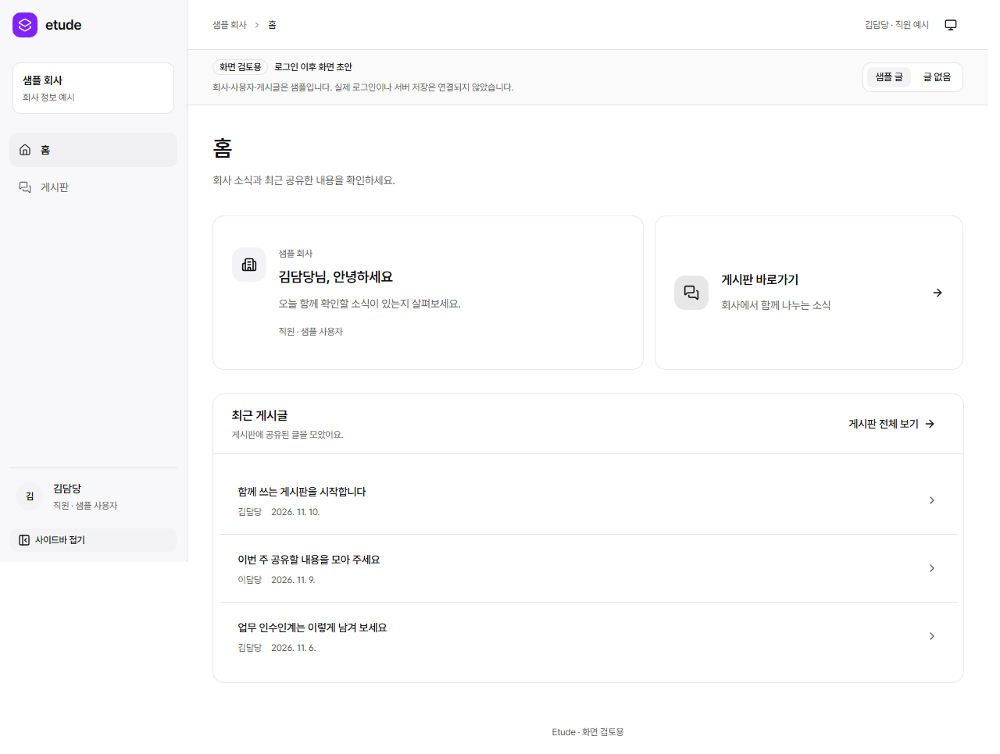

# 홈·게시판 화면 초안 검토 (#119)

로그인 이후 화면의 느낌을 확인하는 샘플 UI다. 회사·사용자·글은 예시이며 실제 인증·서버 저장은 연결하지 않았다. 최종 디자인이나 게시판 API 계약이 아니다.

## 직접 보기

현재 작업 공간의 개발 서버: <http://127.0.0.1:5181/preview>. 같은 PC에서만 접근할 수 있고 서버가 실행 중이어야 한다.

다른 체크아웃에서 재현하려면 Node 26.13.0으로 아래 명령을 실행한다.

```bash
cd web
npm ci
npm run dev --workspace @etude/admin -- --port 5181 --strictPort
```

홈에서 게시판 바로가기 또는 최근 글을 눌러 목록·상세를 확인한다. 상단의 **글 없음**으로 빈 상태를 보고 **샘플 글**로 돌아온다. 헤더의 테마 메뉴는 라이트·다크·시스템 설정을 지원한다. 게시판 생성·설정·검색·댓글·첨부·작성 기능은 이번 초안에 없다.

## 캡처

아래 이미지는 프로덕션 빌드의 Playwright 검사에서 생성했다. 데스크톱은 Desktop Chrome, 모바일은 Chromium의 iPhone 13 에뮬레이션이다. 실제 iOS Safari 검증을 뜻하지 않는다.

| 화면           | 데스크톱                      | 모바일                       |
| -------------- | ----------------------------- | ---------------------------- |
| 홈             | [보기](home-desktop.png)      | [보기](home-mobile.png)      |
| 게시판 목록    | [보기](board-desktop.png)     | [보기](board-mobile.png)     |
| 글 상세        | [보기](post-desktop.png)      | [보기](post-mobile.png)      |
| 글 없는 게시판 | [보기](empty-desktop.png)     | [보기](empty-mobile.png)     |
| 다크 테마 홈   | [보기](home-dark-desktop.png) | [보기](home-dark-mobile.png) |



## 검사 결과와 한계

Windows, Node 26.13.0, npm 11.20.0에서 `npm ci`, `npm run check`, `npm run security:check`를 실행했다. 타입·lint·포맷·프로덕션 빌드와 단위 14개·lint 설정 7개·브라우저 34개 검사가 통과했다. npm audit의 알려진 취약점은 0건이었다. 원격 CI 결과는 PR에 따로 기록한다.

새 화면의 라이트/다크 axe 검사에는 제외 항목을 두지 않았다. 키보드 포커스·모바일 메뉴, 빈 상태/직접 URL/404, 청크 실패·로딩·Provider 오류 복구, 한글 폰트 self-hosting, 실제 CSP와 인라인 스크립트 차단을 확인했다. 테마 선택 후 메뉴가 남는 문제는 공식 `closeOnClick`으로 고치고 닫힘을 검증했다.

실제 인증·권한·테넌트 격리·API·운영 배포와 모든 보조공학 지원은 이번 검증 범위가 아니다. `PreviewPost`는 FE 샘플 타입이다. 여러 게시판 관리 UI와 BE 연동은 승인·반영된 OpenAPI 계약 이후 별도 범위로 진행한다.

## 정리와 보존

UI 가이드 폴더 7개 파일, 기존 Workspace/Settings 시연 페이지와 ScreenSearch를 제거하고 라우트·메뉴·전용 테스트·웹 문서를 갱신했다. 공통 UI·폰트·라이선스·테마·오류 처리·admin-transport와 관련 단위 검사는 재사용했다. 시연 전용 추가 자산·스타일은 main에 없었다.

기존 FE 작업 공간의 #95 미커밋 작업과 PR #116의 랜딩 브랜치는 그대로 보존했다. 이번 브랜치는 main `9a75858`에서 시작했으며 추가 에이전트, 공유 파일 변경, 병합 또는 공개 배포는 수행하지 않았다.
