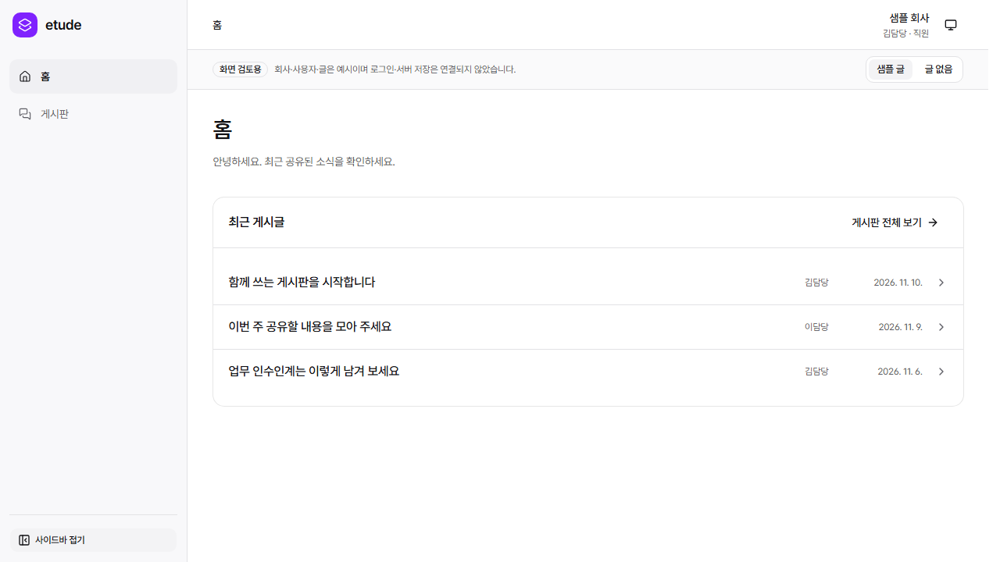

# 홈·게시판 첫 UI/UX 개선 (#122)

[소유자 승인](https://github.com/LiamKim-DaeYong/etude/issues/122#issuecomment-6770929216)에 따라 기존 틀에서 정보 위계·크기·여백을 정리했다. 새 기능이나 API 연동은 추가하지 않았다.

## 먼저 비교하기

- 기존 초안: <http://127.0.0.1:5181/preview>
- 개선 화면: <http://127.0.0.1:5182/preview>
- 개선 게시판: <http://127.0.0.1:5182/preview/boards/general>

같은 PC에서 해당 서버가 실행 중이어야 한다. 새 체크아웃에서는 Node 26.13.0으로 `cd web`, `npm ci`, `npm run dev --workspace @etude/admin -- --port 5182 --strictPort`를 실행한다. 두 서버를 따로 띄우면 같은 조건으로 비교할 수 있다.

## 바뀐 점

| 이전                                         | 개선                                                                 |
| -------------------------------------------- | -------------------------------------------------------------------- |
| 회사/사용자가 사이드바·헤더·인사 카드에 반복 | 회사·사용자는 헤더의 한 영역으로 통합                                |
| 큰 인사 카드와 바로가기 카드 다음에 최근 글  | 짧은 인사 뒤 최근 글을 첫 콘텐츠로 배치                              |
| 카드 바로가기와 전체 보기 링크가 경쟁        | 최근 글 영역의 기존 전체 보기 링크 유지                              |
| 제목과 보조 정보가 같은 흐름으로 쌓임        | 제목 16px 중심, 작성자·날짜는 데스크톱 열 정렬 / 모바일 아래 보조 행 |
| 목록의 큰 행 간격과 반복 설명                | 기존 공통 카드 안에서 패딩·행 높이·설명 정리                         |

홈/게시판 메뉴, 라우트, 글 상세, 빈 상태, 샘플 전환, 테마 기능을 유지했다. 밝은 중립 배경과 기존 강조색 하나를 재사용하며 다크 모드도 유지한다. 샘플 안내는 업무 콘텐츠와 별도 띠에서 계속 표시한다. 기존 공통 UI·폰트·브랜드·데이터·CSP·의존성은 바꾸지 않았다. 글 상세 본문은 기존 14px를 유지하고 목록 제목은 16px로 정리했다.

## 같은 조건의 전후 캡처

프로덕션 빌드 / 라이트 테마 / 동일 샘플 / 같은 Playwright 설정이다. 데스크톱은 1280×720, 모바일은 390×664 CSS px(Chromium iPhone 13 에뮬레이션)이다. 전체 페이지 캡처이므로 콘텐츠 길이에 따라 이미지 높이는 달라진다. 이미지 크기를 인위적으로 수정하지 않았다.

이전 캡처는 PR #123의 커밋 `64d22af`에 보존된 `web/docs/reviews/119` 원본을 그대로 복사했다. 개선 캡처는 이번 브랜치의 최종 로컬 검사에서 생성했다.

| 화면 / 조건       | 이전                             | 개선                            |
| ----------------- | -------------------------------- | ------------------------------- |
| 홈 / 데스크톱     | [보기](before-home-desktop.png)  | [보기](after-home-desktop.png)  |
| 홈 / 모바일       | [보기](before-home-mobile.png)   | [보기](after-home-mobile.png)   |
| 게시판 / 데스크톱 | [보기](before-board-desktop.png) | [보기](after-board-desktop.png) |
| 게시판 / 모바일   | [보기](before-board-mobile.png)  | [보기](after-board-mobile.png)  |

다크 테마 개선: [데스크톱](after-home-dark-desktop.png), [모바일](after-home-dark-mobile.png).

## 검증과 한계

Windows / Node 26.13.0 / npm 11.20.0에서 `npm ci`, `npm run check`, `npm run security:check`를 실행했다. 타입·lint·포맷·프로덕션 빌드·단위 14개·lint 설정 7개·브라우저 34개 검사 통과, 알려진 취약점 0건이다. 원격 CI는 PR에서 별도 기록한다.

첫 게시글이 두 뷰포트의 초기 화면에 완전히 들어오는지, 회사 정보가 한 번만 표시되는지 확인했다. 메뉴/목록/상세·빈 상태·직접 URL·404·키보드/포커스·테마/시스템 설정·폰트·CSP·로딩/오류 복구 검사는 유지했다. axe 검사에서 요소나 규칙을 제외하지 않았다. 모바일 Sheet의 기존 열림 애니메이션 도중 대비를 측정하지 않도록 실제 유한 애니메이션 완료를 기다린다.

기존 원문 [Web Interface Guidelines](https://raw.githubusercontent.com/vercel-labs/web-interface-guidelines/main/command.md)를 2026-11-10 UTC에 다시 읽고 변경한 화면의 제목/본문 위계, 긴 제목 줄바꿈, 의미 있는 링크/버튼, 포커스와 대비를 점검했다. 한국어 문구와 저장소의 공식 UI/CSP 규칙을 우선했다.

실제 대표·직원에게 설명 없이 최근 글 읽기/작성을 시도하게 하는 사용성 검증은 미수행이다. 실제 Safari·보조공학 전체 지원도 이번 자동 검사만으로 보증하지 않는다. 글 작성·수정·삭제 UX 명세와 기능/API는 이번 승인 범위에 포함하지 않았으며 후속 기획으로 남는다.

## PR 포함 관계와 보존

최신 main `9a75858`에서 #122 이슈 브랜치를 만들었다. PR #123의 미병합 화면 기반 `64d22af`를 커밋 `3c51a15`로 cherry-pick한 뒤 이번 개선을 적용했다. main 대상 PR에는 #119 기반도 포함되므로 이번 개선 커밋의 diff를 별도로 제공한다. PR #123은 병합·폐기하지 않았고 병합 순서는 소유자가 결정한다.

기존 FE의 #95 미커밋 7개 항목, PR #116, #119 작업 공간은 그대로 보존했다. 추가 에이전트나 BE/저장소 공유 파일 변경, 공개 배포는 수행하지 않았다.
